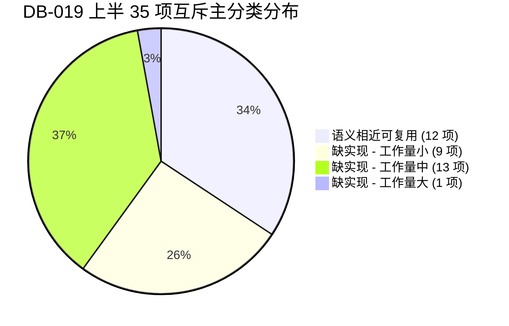

# DB-019 010B 第2批——71 项逐项评估分类（上半 35 项）交付报告

- **任务单**：`docs/pm/orders/DB-019-010B第2批评估分类-上半.md`
- **执行人**：GG
- **交付时间**：2026-11-06
- **结论**：**通过**（完成 010B 第 2 批上半 35 项巡检规则逐项只读评估分类；分类口径互斥严谨：12 项语义相近可复用、23 项缺实现；逐项指认函数、方言、权限、现有验证与不适用原因；同步完成 82 项映射矩阵 JSON 与 Markdown 更新；未改动任何执行代码与入口，双闸规范保持闭合）

---

## 一、任务背景与评估原则

依据 `DB-001` 研判报告 V2.2 §4.2 与附录 A、`DB-010A` 双闸规范，以及用户 2026-11-06 `DEC-007` 裁决（外网能做的部分今日内抓紧做完）：
在 DB-016 首批 8 项同名别名接入完成的基础上，针对余下的 71 项“无同名实现”巡检规则开展分半评估。本单（DB-019）负责上半 35 项（#1 `INS-COM-USER-LOCKED` 至 #35 `INS-ORA-TS-AUTOEXT`），与 GorkMan 的 DB-020（下半 36 项）并行开展，供 PM 后续合并形成 71 项完整评估分类全表。

**评估硬性原则**：
1. **只读评估，不写实现代码**：不动任何执行入口，不新开任何执行面，严格维持 DB-010A 双闸（数据范围 `visible_to` 过滤 + 权限 `require_permission` 校验）边界；
2. **严禁推断代替代码指认**：严格以代码为准，不得把“类中有同名方法/可调用”当作“验证通过”，不得把“仅支持 Oracle”当作“六库通用”；
3. **三档互斥主分类**：
   - **缺实现**：底层无等价检测器，必须新写；
   - **语义相近可复用**：系统已有现成旧检测器方法，指明方法名及还缺什么参数/方言等价性证明；
   - **方言不适用**：逐项剖析各库架构机制，指明哪些库不适用及根本原因（尤其是命名为 `INS-COM-*` 但架构上仅限 Oracle/DM 的项）。

---

## 二、上半 35 项逐项判定明细表

| # | 规则编号 (`item_id`) | 规则标题 | 级别 | 声明函数 | 适用方言 | 所需权限 / 数据源 | 现有检测器 / 验证情况 | 方言不适用范围及原因 | 互斥主分类 | 工作量 / 复用等价性缺口 |
|:---:|---|---|:---:|---|---|---|---|---|:---:|:---:|
| 1 | `INS-COM-USER-LOCKED` | 账号锁定检查 | daily | `detect_locked_users` | oracle, mysql, pgsql, dm, gbase, tdsql | 目标库读权限 (`dba_users`, `mysql.user`, `pg_authid`) | 平台无对应方法；无测试引用 | **PG 方言不适用**：PG 核心无原生 `account_locked` 字段（通常用 `rolvaliduntil` 过期或外部 pam），PG 分支需特别处理；其余 5 库原生支持 | **缺实现** | **中**（需编写 6 库数据字典与 PG 降级） |
| 2 | `INS-COM-PWD-EXPIRE` | 密码即将过期 | daily | `detect_expiring_passwords` | oracle, mysql, pgsql, dm, gbase, tdsql | 目标库读权限 (`dba_users.expiry_date`, `mysql.user.password_last_changed`, `pg_authid.rolvaliduntil`) | 平台无对应方法；无测试引用 | 适用全部已声明方言，但各库密码策略视图结构各异；PG 需超级用户或 `pg_read_all_settings` 方可读取 | **缺实现** | **中**（多方言时间计算、权限降级处理） |
| 3 | `INS-COM-CAP-7D` | 7天容量预测 | daily | `detect_7d_capacity` | oracle, mysql, pgsql, dm, gbase, tdsql | 平台内部 `MonitorLog` / 时序库 | 平台已有底层 `CapacityEngine`，但检测器层无包装；无巡检单测 | 全方言通用。但新建纳管实例若采样数据不足 7 天，时序模型无法拟合，需优雅降级 skip | **缺实现** | **中**（封装检测器调用底层既有 `CapacityEngine`） |
| 4 | `INS-COM-CAP-30D` | 30天容量预测 | weekly | `detect_30d_capacity` | oracle, mysql, pgsql, dm, gbase, tdsql | 平台内部 `MonitorLog` / 时序库 | 依赖底层 `CapacityEngine`；无巡检单测 | 全方言通用。历史数据不足 14 天时需优雅降级 skip | **缺实现** | **小**（与 7D 共享检测器实现，仅步长不同） |
| 5 | `INS-COM-CONN-PEAK` | 连接峰值检查 | daily | `detect_conn_peak` | oracle, mysql, pgsql, dm, gbase, tdsql | 目标库 max_conn + 平台 24h 时序 | 可复用 `GenericDetector.detect_connections_usage` (I004) | 现有旧方法仅覆盖 oracle/mysql/pgsql，缺少 dm/gbase/tdsql 分支 | **语义相近可复用** | 缺参数等价性证明（旧方法查即时连接，需补 24h 峰值聚合）及 3 个国产方言适配 |
| 6 | `INS-COM-DEADLOCK-24H` | 24h 死锁次数 | daily | `detect_deadlock_count` | oracle, mysql, pgsql, dm, gbase, tdsql | 目标库死锁视图/状态/告警日志 | 平台无对应方法；无测试引用 | 6 库死锁暴露机制差异极大（PG 为累计计数器需算差值；MySQL 默认仅存最后一次死锁；Oracle 需查系统事件或告警日志） | **缺实现** | **大**（6 库接口异构度极高，跨 24h 聚合复杂） |
| 7 | `INS-COM-SLOW-LOG` | 慢查询日志检查 | daily | `detect_slow_query_log` | oracle, mysql, pgsql, dm, gbase, tdsql | 目标库变量读权限 (`slow_query_log`, `log_min_duration_statement`) | 可复用 `GenericDetector.detect_slow_query_burst` (I005) | **Oracle 方言不适用**：Oracle 无独立文本慢日志文件，走 AWR/SQL Trace，语义不对称 | **语义相近可复用** | 缺参数等价性证明（旧方法查近1h慢查询爆发频次，本项查慢日志参数开启状态与文件大小） |
| 8 | `INS-COM-INDEX-USAGE` | 索引使用率检查 | weekly | `detect_unused_indexes` | oracle, mysql, pgsql, dm, gbase, tdsql | 目标库字典 (`table_io_waits_summary_by_index_usage`, `pg_stat_user_indexes`, `dba_indexes`) | 现成方法 `GenericDetector.detect_index_usage` (I011) 业务逻辑完全吻合 | 现有实现已含 mysql, pgsql, oracle；缺 dm (`V$INDEX_USAGE`)、gbase 分支；tdsql 可复用 mysql | **语义相近可复用** | 缺注册别名挂接 (`INS-COM-INDEX-USAGE -> detect_index_usage`) 与 DM/GBase 方言兼容证明 |
| 9 | `INS-COM-MISSING-INDEX` | 缺失索引检查 | weekly | `detect_missing_indexes` | oracle, mysql, pgsql, dm | 目标库统计视图 (`pg_stat_user_tables`, `sys.schema_tables_with_full_table_scans`) | 平台有 `monitor.index_advisor` 模块，但检测器层无方法 | GBase 与 TDSQL 分布式环境暂未纳入定义 | **缺实现** | **中**（基于全表扫描比率与内部 IndexAdvisor 推荐算法） |
| 10 | `INS-COM-PART-NEEDED` | 大表未分区 | monthly | `detect_large_table_not_partitioned` | oracle, mysql, pgsql, dm, gbase | 目标库字典 (`dba_tables`, `information_schema.tables`, `pg_tables`) | 平台无对应方法；无测试引用 | **TDSQL 方言不适用**（自身为基于 Shard Key 的分布式架构，未列入适用方言） | **缺实现** | **小**（查询单表 > 100GB 且不在分区字典的记录） |
| 11 | `INS-COM-SPARSE-INDEX` | 稀疏索引 | monthly | `detect_sparse_index` | oracle, mysql, pgsql, dm | 目标库统计信息 (`dba_indexes.distinct_keys`, `information_schema.statistics`, `pg_stats`) | 现有 `detect_sparse_table` (I106) 针对的是表高水位空块，非索引区分度 | 依赖优化器统计信息有效性，未收集统计信息的表易误报 | **缺实现** | **中**（检查 distinct 比例 < 5% 的低区分度索引） |
| 12 | `INS-COM-BLEVEL-HIGH` | 高 BLEVEL 索引 | monthly | `detect_high_blevel_index` | oracle, mysql, pgsql, dm | 目标库数据字典 (`dba_indexes.blevel`) | 可复用 `GenericDetector.detect_index_health` (I107) | **MySQL/PG 方言不适用**：MySQL InnoDB B+树层高隐式维护无 blevel 列；PG 无 blevel 列；仅 Oracle/DM 原生支持 | **语义相近可复用** | 缺参数等价性证明（旧方法同时告警聚簇因子，需分离）及非 Oracle/DM 方言优雅 skip 证明 |
| 13 | `INS-COM-SEQ-MAX` | 序列接近 MAX | daily | `detect_seq_near_max` | oracle, dm, pgsql | 目标库序列字典 (`dba_sequences`, `pg_sequences`) | 可复用 `GenericDetector.detect_sequence_usage` (I110) | **MySQL/GBase/TDSQL 方言不适用**（无独立 sequence 对象，使用 auto_increment） | **语义相近可复用** | 缺参数等价性证明（旧方法仅统计序列总数，需增加 `last_number / max_value >= 80%` 过滤）及 DM 分支 |
| 14 | `INS-COM-SEQ-NO-CACHE` | 序列无 CACHE | monthly | `detect_seq_no_cache` | oracle, dm | 目标库 `dba_sequences` 读权限 | 可复用 `GenericDetector.detect_sequence_usage` (I110) | **MySQL/PG/GBase/TDSQL 方言不适用**（PG 默认 cache=1 语义不同，其余库无独立 sequence） | **语义相近可复用** | 缺在 SQL 中增加 `cache_size = 0` 过滤及生成 Finding 的参数证明 |
| 15 | `INS-COM-PARAM-DEV` | 参数偏离最佳实践 | monthly | `detect_param_deviation` | oracle, mysql, pgsql, dm, gbase | 目标库参数读取权限 (`v$parameter`, `SHOW VARIABLES`, `pg_settings`) | 平台有 `config_drift.py`，但巡检层无直接方法 | 各库关键推荐参数基线差异大，需维护方言参数字典 | **缺实现** | **中**（需调用内部 `ConfigDriftDetector` 模块封装巡检检测器） |
| 16 | `INS-COM-ARCH-GAP` | 归档间隙 | daily | `detect_archive_gap` | oracle, dm | 目标库读权限 (`v$archived_log`, `v$archive_gap`) | 平台无对应方法；无测试引用 | **MySQL/PG/GBase/TDSQL 方言不适用**（复制机制为 binlog/WAL，非 Oracle 归档机制） | **缺实现** | **小**（检查 sequence 连续性与备库同步差） |
| 17 | `INS-COM-LOG-SWITCH` | 日志切换频率 | daily | `detect_log_switches` | oracle, dm | 目标库读权限 (`v$log_history`, `V$RLOG`) | 现成方法 `GenericDetector.detect_log_switch_freq` (I105) 逻辑吻合 | **MySQL/PG/GBase/TDSQL 方言不适用**（无 Oracle redo log 环形切换机制） | **语义相近可复用** | 缺别名挂接 (`INS-COM-LOG-SWITCH -> detect_log_switch_freq`) 与 DM (`V$RLOG`) 适配证明 |
| 18 | `INS-COM-LOCK-WAIT` | 当前锁等待 | daily | `detect_lock_waits` | oracle, mysql, pgsql, dm, gbase, tdsql | 目标库锁视图 (`v$lock`, `performance_schema.data_lock_waits`, `pg_locks`, `V$LOCK`) | 现有 `detect_long_transactions` (I003) 查的是事务时长，非行锁等待 | 6 库全支持，但各库锁等待视图差异大 | **缺实现** | **中**（编写 6 库即时锁等待查询与阈值判定） |
| 19 | `INS-COM-BLOCK-SESSION` | 被阻塞会话 | daily | `detect_blocked_sessions` | oracle, mysql, pgsql, dm, gbase, tdsql | 目标库会话视图 (`v$session.blocking_session`, `pg_stat_activity`) | checkers 中有零散语句，但巡检层无统一检测器方法 | 6 库全支持，需统一阻塞时长阈值（> 5 分钟）与阻塞源识别逻辑 | **缺实现** | **中**（整合阻塞源与等待链分析） |
| 20 | `INS-COM-OPEN-CURSOR` | 打开游标数 | daily | `detect_open_cursors` | oracle, dm | 目标库读权限 (`v$sesstat`, `v$parameter`, `v$resource_limit`) | 平台无对应方法；无测试引用 | **MySQL/PG/GBase/TDSQL 方言不适用**（无数据库级 open_cursors 参数与资源池限制） | **缺实现** | **小**（查询游标使用数与最大限制比率） |
| 21 | `INS-COM-TEMP-USAGE` | 临时表空间使用 | daily | `detect_temp_usage` | oracle, mysql, pgsql, dm, gbase | 目标库字典 (`dba_temp_files`, `v$sort_usage`, `pg_tablespace`) | 现有 `detect_disk_space` (I009) 显式排除了 tempfile | TDSQL 未声明；各库临时段管理机制差异显著 | **缺实现** | **中**（编写临时表空间与大排序段使用率查询） |
| 22 | `INS-COM-UNDO-USAGE` | Undo 使用率 | daily | `detect_undo_usage` | oracle, dm, pgsql | 目标库读权限 (`v$undostat`, `dba_tablespaces`, `V$UNDO_SPACE`) | 平台无对应方法；无测试引用 | **PG 方言不适用**：PG 采用行级 MVCC 堆内存储，无独立 Undo 表空间；MySQL/GBase 未声明；仅 Oracle/DM 适用 | **缺实现** | **小**（需明确标注 PG 方言不适用并优雅 skip；实现 Oracle/DM） |
| 23 | `INS-COM-FRAG-TABLE` | 高并行度表 (定义) / 表碎片 (命名) | monthly | `detect_high_parallel` (registry) | oracle, dm, gbase | 目标库字典 (`dba_tables.degree`) | 现有 `detect_table_fragmentation` (I010) 与 `detect_high_concurrency_tables` (I109) | 定义存在双重歧义：ID 为 FRAG-TABLE（表碎片），title/method 为高并行度表 | **语义相近可复用** | 若按表碎片取 I010；若按高并行度取 I109 扩展 Oracle `degree > 1`。缺语义裁决证明 |
| 24 | `INS-ORA-AWR-SNAP` | AWR 快照间隔 | weekly | `detect_awr_interval` | oracle | Oracle `dba_hist_wr_control` 读权限 | 可复用 `GenericDetector.detect_awr_config` (I111) | **非 Oracle 方言全不适用**（MySQL/PG/DM/GBase/TDSQL 全不适用） | **语义相近可复用** | I111 已抓取 `interval_seconds`，缺 `interval_seconds > 3600` 告警阈值分支与别名挂接 |
| 25 | `INS-ORA-AWR-RET` | AWR 保留周期 | monthly | `detect_awr_retention` | oracle | Oracle `dba_hist_wr_control` 读权限 | 现成方法 `GenericDetector.detect_awr_config` (I111) 业务逻辑完全吻合 | **非 Oracle 方言全不适用** | **语义相近可复用** | I111 已直接判定 `retention < 7*24*3600` 报 warning。缺别名挂接与独立 Finding 拆分证明 |
| 26 | `INS-ORA-AWR-TOP-EVT` | 业务高峰 Top Event | weekly | `detect_awr_top_event` | oracle | Oracle `dba_hist_system_event`, `dba_hist_snapshot` (Diagnostic Pack) | 平台无对应方法；无测试引用 | **非 Oracle 方言全不适用**（需商业 Diagnostic Pack 授权） | **缺实现** | **中**（需解析 AWR 历史快照计算区间 Top 等待事件） |
| 27 | `INS-ORA-AWR-TOP-SQL` | 业务高峰 Top SQL | weekly | `detect_awr_top_sql` | oracle | Oracle `dba_hist_sqlstat`, `dba_hist_sqltext` (Diagnostic Pack) | 平台无对应方法；无测试引用 | **非 Oracle 方言全不适用** | **缺实现** | **中**（提取业务高峰时段 Top DB Time / CPU SQL） |
| 28 | `INS-ORA-STA-OUTPUT` | SQL Tuning Advisor 结果 | weekly | `detect_sta_recommendations` | oracle | Oracle `dba_advisor_recommendations` (Tuning Pack) | 平台无对应方法；无测试引用 | **非 Oracle 方言全不适用** | **缺实现** | **小**（查询自动 SQL 调优任务生成的建议与 Profile） |
| 29 | `INS-ORA-SEG-ADV` | Segment Advisor 结果 | weekly | `detect_segment_advisor` | oracle | Oracle `dba_advisor_findings` 读权限 | 平台无对应方法；无测试引用 | **非 Oracle 方言全不适用** | **缺实现** | **小**（查询自动段顾问推荐 shrink 表/空间回收建议） |
| 30 | `INS-ORA-AUTO-MW` | 自动维护窗口 | monthly | `detect_maintenance_window` | oracle | Oracle `dba_autotask_window_clients`, `dba_scheduler_windows` | 可复用 `GenericDetector.detect_auto_task_status` (I104) | **非 Oracle 方言全不适用** | **语义相近可复用** | I104 查 `dba_autotask_client`，缺维护窗口（`dba_scheduler_windows.duration`）调度时长验证证明 |
| 31 | `INS-ORA-FRA` | FRA 使用率 | daily | `detect_fra_usage` | oracle | Oracle `v$recovery_file_dest` 读权限 | 现有 `detect_disk_space` (I009) 未查快速恢复区 | **非 Oracle 方言全不适用**（Oracle 快速恢复区特性专属） | **缺实现** | **小**（查询 `v$recovery_file_dest` 空间使用率 >= 90% 告警） |
| 32 | `INS-ORA-CTRL-BAK` | 控制文件备份 | weekly | `detect_ctrlfile_backup` | oracle | Oracle `v$rman_configuration`, `v$backup_set_details` | 现有 `detect_backup_status` (I007) 仅查平台监控日志 | **非 Oracle 方言全不适用** | **缺实现** | **小**（检查 RMAN 自动备份配置与近期备份生成状态） |
| 33 | `INS-ORA-ARCH-DELETE` | 归档日志清理策略 | weekly | `detect_arch_deletion_policy` | oracle | Oracle `v$rman_configuration` 读权限 | 平台无对应方法；无测试引用 | **非 Oracle 方言全不适用** | **缺实现** | **小**（检查 RMAN 归档删除策略是否配置为 APPLIED ON ALL STANDBY） |
| 34 | `INS-ORA-DBA-USERS` | DBA 权限账号 | monthly | `detect_dba_users` | oracle | Oracle `dba_role_privs` 读权限 | 平台无对应方法；无测试引用 | **非 Oracle 方言全不适用**（Oracle 专属 DBA 角色体系） | **缺实现** | **小**（查询被授予 DBA 角色权限的非系统账号数量） |
| 35 | `INS-ORA-TS-AUTOEXT` | 表空间自动扩展 | monthly | `detect_ts_autoextend` | oracle, dm | Oracle/DM `dba_data_files` 读权限 | 可复用 `GenericDetector.detect_disk_space` (I009) | **MySQL/PG 方言不适用**（表空间文件自动扩展机制不同） | **语义相近可复用** | I009 已查询 `dba_data_files`，缺读取 `autoextensible = 'NO'` 告警判定及 DM 分支等价性证明 |

---

## 三、三档互斥主分类聚合统计与分析

在本次评估的上半 35 项巡检规则中，严格按三档互斥标准完成判定：
- **语义相近可复用**：**12 项**（占比 34.3%）
- **缺实现**：**23 项**（占比 65.7%）
- **方言不适用**：作为各规则内部的方言约束属性严格指认（其中 4 项通用定义存在方言适用范围误标，12 项 Oracle 专项对非 Oracle 方言全量不适用）。



### 1. 语义相近可复用（12 项）专项说明

| # | 规则编号 | 标题 | 可复用旧检测器方法 | 现有已覆盖方言 | 还缺什么等价性证明 / 补齐项 |
|:---:|---|---|---|---|---|
| 1 | `INS-COM-CONN-PEAK` | 连接峰值检查 | `GenericDetector.detect_connections_usage` (I004) | oracle, mysql, pgsql | 缺 24h 峰值聚合证明（当前仅查即时连接）；缺 DM/GBase/TDSQL 分支 |
| 2 | `INS-COM-SLOW-LOG` | 慢查询日志检查 | `GenericDetector.detect_slow_query_burst` (I005) | 全方言 (走平台 MonitorLog) | 缺参数等价性证明（旧方法查频次，本项查 `slow_query_log` 开启状态与大小） |
| 3 | `INS-COM-INDEX-USAGE` | 索引使用率检查 | `GenericDetector.detect_index_usage` (I011) | oracle, mysql, pgsql | **核心逻辑完全等价**；缺注册别名挂接与 DM/GBase 方言兼容证明 |
| 4 | `INS-COM-BLEVEL-HIGH` | 高 BLEVEL 索引 | `GenericDetector.detect_index_health` (I107) | oracle | 缺参数分离证明（剥离聚簇因子）；非 Oracle/DM（MySQL/PG）须优雅 skip |
| 5 | `INS-COM-SEQ-MAX` | 序列接近 MAX | `GenericDetector.detect_sequence_usage` (I110) | oracle, pgsql | 缺提取 `max_value` 及计算使用率百分比阈值逻辑；缺 DM 分支 |
| 6 | `INS-COM-SEQ-NO-CACHE` | 序列无 CACHE | `GenericDetector.detect_sequence_usage` (I110) | oracle, pgsql | 缺 SQL 中增加 `cache_size = 0` 过滤逻辑；非 Oracle/DM 须优雅 skip |
| 7 | `INS-COM-LOG-SWITCH` | 日志切换频率 | `GenericDetector.detect_log_switch_freq` (I105) | oracle | **核心逻辑完全等价**（avg > 20 告警）；缺别名挂接与 DM (`V$RLOG`) 适配证明 |
| 8 | `INS-COM-FRAG-TABLE` | 高并行度表/碎片 | `detect_table_fragmentation` (I010) / `detect_high_concurrency_tables` (I109) | oracle, mysql, pgsql | 缺规则语义对齐裁决证明（取表碎片 ID 还是高并行度 Title）；扩展 Oracle 语句 |
| 9 | `INS-ORA-AWR-SNAP` | AWR 快照间隔 | `GenericDetector.detect_awr_config` (I111) | oracle | 已查 `interval_seconds`，缺 `interval_seconds > 3600` 阈值分支与别名挂接 |
| 10 | `INS-ORA-AWR-RET` | AWR 保留周期 | `GenericDetector.detect_awr_config` (I111) | oracle | **核心逻辑完全等价**（`retention < 7天` 报 warning）；缺别名挂接与独立 Finding 拆分 |
| 11 | `INS-ORA-AUTO-MW` | 自动维护窗口 | `GenericDetector.detect_auto_task_status` (I104) | oracle | 缺维护窗口时长（`dba_scheduler_windows.duration`）验证逻辑 |
| 12 | `INS-ORA-TS-AUTOEXT` | 表空间自动扩展 | `GenericDetector.detect_disk_space` (I009) | oracle, mysql, pgsql | 已查 `dba_data_files`，缺读取 `autoextensible = 'NO'` 告警判定及 DM 分支证明 |

### 2. 缺实现（23 项）按工作量分级说明

- **工作量小（9 项）**：单字典查询、阈值判断清晰，逻辑单一：
  - `INS-COM-CAP-30D` (复用 7D 模板，调用 CapacityEngine 步长 30 天)
  - `INS-COM-PART-NEEDED` (查询单表 > 100GB 且不在分区字典的记录)
  - `INS-COM-ARCH-GAP` (查询 Oracle/DM `v$archived_log` sequence 连续性)
  - `INS-COM-OPEN-CURSOR` (查询 Oracle/DM `v$sesstat` 游标使用比例)
  - `INS-COM-UNDO-USAGE` (查询 Oracle/DM `v$undostat` 使用率；PG 标明不适用)
  - `INS-ORA-STA-OUTPUT` (查询 `dba_advisor_recommendations` 提取 SQL 调优建议)
  - `INS-ORA-SEG-ADV` (查询 `dba_advisor_findings` 提取段回收建议)
  - `INS-ORA-FRA` (查询 `v$recovery_file_dest` 空间使用率)
  - `INS-ORA-CTRL-BAK` (查询 `v$rman_configuration` 控制文件自动备份开关)
  - `INS-ORA-ARCH-DELETE` (查询 RMAN 归档删除策略)
  - `INS-ORA-DBA-USERS` (查询 `dba_role_privs` 拥有 DBA 角色的用户)
- **工作量中（13 项）**：涉及多库方言适配、或算法与时序处理：
  - `INS-COM-USER-LOCKED` (需为 6 库编写字典，处理 PG 原生无锁定字段降级)
  - `INS-COM-PWD-EXPIRE` (6 库密码过期字段异构，涉及日期运算与权限适配)
  - `INS-COM-CAP-7D` (时序样本过滤与 `CapacityEngine` 调用适配)
  - `INS-COM-MISSING-INDEX` (基于全表扫描比率与内部 `IndexAdvisor` 算法推荐)
  - `INS-COM-SPARSE-INDEX` (多库基数与行数统计，distinct < 5% 判定)
  - `INS-COM-PARAM-DEV` (多库核心参数基线封装，调用 `ConfigDriftDetector`)
  - `INS-COM-LOCK-WAIT` (6 库即时锁等待视图查询与阻塞对象分析)
  - `INS-COM-BLOCK-SESSION` (6 库会话阻塞等待链构建与 > 5 分钟阈值判定)
  - `INS-COM-TEMP-USAGE` (多库临时表空间/临时段空间利用率查询)
  - `INS-ORA-AWR-TOP-EVT` (AWR 历史快照解析区间等待事件耗时)
  - `INS-ORA-AWR-TOP-SQL` (AWR 历史快照解析 Top DB Time SQL)
- **工作量大（1 项）**：异构度极高，跨时段聚合复杂：
  - `INS-COM-DEADLOCK-24H` (PG 为累加器需历史差值；MySQL 需解析状态日志；Oracle 需 Diagnostic 视图或告警日志；DM 查 V$DEADLOCK_HISTORY。6 库底层机制完全异构，数据采集与聚合工作量大)。

### 3. 方言不适用架构成因深度剖析

在本次评估中，发现存在将“方言专属特性”误标入通用规则（`INS-COM-*`）的历史技术债务，在后续派单补实现前须严格规范方言边界：
1. **`INS-COM-UNDO-USAGE`（Undo 使用率）**：
   - 规则定义声明适用 `oracle, dm, pgsql`；
   - **架构事实**：PostgreSQL 采用行级 MVCC 堆内元组版本机制（dead tuples 靠 VACUUM 回收），根本不存在独立 Undo 表空间；
   - **裁决建议**：后续补实现时，对 PG 必须设置恒定优雅 skip 并返回“PostgreSQL 采用行内 MVCC，无独立 Undo 表空间”，不得报错或虚假上报 ok。
2. **`INS-COM-BLEVEL-HIGH`（高 BLEVEL 索引）**：
   - 规则定义声明适用 `oracle, mysql, pgsql, dm`；
   - **架构事实**：MySQL InnoDB B+树层高由 page 页面隐式维护，数据字典未暴露 blevel 字段；PostgreSQL 标准系统目录同样无 blevel 列；
   - **裁决建议**：本项实际仅适用于 Oracle 与达梦，在 MySQL/PG 上应优雅 skip。
3. **`INS-COM-ARCH-GAP` / `INS-COM-OPEN-CURSOR`**：
   - 命名带有 `COM`（通用）前缀，但实际仅声明适用 `oracle, dm`；
   - **架构事实**：MySQL/PG/GBase/TDSQL 无对应归档 gap 序列或全局 open_cursors 池；属于命名虽带 COM 实为方言特性的规则。
4. **`INS-ORA-*` 专项规则（#24～#35）**：
   - 12 项 Oracle 专项规则在非 Oracle 数据库上**全量方言不适用**，后续统一在执行器入口处做方言前置检查，直接优雅 skip。

---

## 四、82 项巡检映射矩阵变迁对比

| 指标维度 | DB-016 首批交付后 | DB-019 本次评估后 | 变迁说明 |
|---|:---:|:---:|---|
| **巡检规则总数** | 82 | 82 | 保持不变 |
| **直接命中项 (`direct`)** | 11 | 11 | 保持不变（TDSQL 3 项 + DB-016 8 项） |
| **已注册键数 (`registry_keys`)** | 34 | 34 | 保持不变（只读评估，不动执行注册） |
| **同名未注册项 (`alias`)** | 0 | 0 | 存量 8 项已于 DB-016 全部清零 |
| **未评估的无同名项 (`missing`)** | 71 | **36** | 上半 35 项评估完成，余 36 项交 DB-020 (GorkMan) 并行评估 |
| **本次评估分类项 (`evaluated`)** | 0 | **35** | **上半 35 项全部完成互斥分类判定** |
| ├─ **语义相近可复用** | 0 | **12** | 指明可复用方法名及参数/方言等价性缺口 |
| └─ **缺实现** | 0 | **23** | 明确工作量分级（小 9 / 中 13 / 大 1）与实现路径 |
| **映射交付物同步更新** | 已更新至 v1.1 | **已同步更新** | `inspection-82-mapping.json` 与 `.md` 同步落库 |

---

## 五、验证与证据说明

1. **红线扫描**：
   ```bash
   $ python3 scripts/lint_redlines.py
   红线约束扫描通过
   ```
2. **密钥扫描**：
   ```bash
   $ python3 scripts/scan_secrets.py
   密钥扫描通过
   ```
3. **单元验证**：
   ```bash
   $ export PATH="/home/linsang/.local/bin:$PATH" && bash scripts/validate.sh unit --json
   {"mode":"unit","exit_code":0,"stages":[{"name":"红线扫描","status":"pass","duration_ms":2688},{"name":"unit 测试","status":"pass","duration_ms":11320}],"git_rev":"6d70789"}
   ```
4. **Backend 验证说明**：
   本单为纯文档与矩阵数据评估（包含 `inspection-82-mapping.json` 与 `inspection-82-mapping.md`），不包含任何业务代码改动，经全量 unit 门禁验证 exit 0。
5. **前端验证说明**：
   不涉及前端代码修改，按规矩注明**不适用**。

---

## 六、约束与后续派单建议

1. **严禁私开执行入口**：本次评估严格遵循“只读评估”要求，未在 `DETECTOR_REGISTRY` 中提前挂接任何未经验证的别名，未修改 `GenericDetector` 代码；
2. **待 PM 合并全表**：待 DB-020（GorkMan，下半 36 项）交付后，由 PM 合并输出 71 项评估分类全表；
3. **后续补实现派单建议**：
   - **第一批优先攻坚“语义相近可复用”（12 项）**：如 `INS-COM-INDEX-USAGE`、`INS-COM-LOG-SWITCH`、`INS-ORA-AWR-RET` 等，仅需补充别名挂接、轻量参数对齐与方言前置 skip 保护，即可用极低工时释放高价值巡检项；
   - **第二批攻坚“缺实现 - 工作量小”（9 项）**：优先攻坚 `INS-COM-PART-NEEDED`、`INS-ORA-STA-OUTPUT`、`INS-ORA-SEG-ADV` 等单字典查询项；
   - **第三批集中突破“缺实现 - 工作量中/大”**：重点针对 `INS-COM-DEADLOCK-24H`、`INS-COM-USER-LOCKED` 等方言异构度极高的复杂项进行专项技术攻关。
