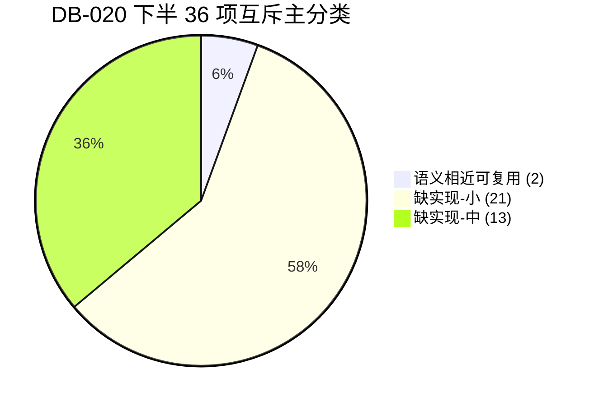

**结论：通过**（v1.0。下半 36 项只读分类完成，互斥主分类只有两档：语义相近可复用 2、缺实现 34。缺实现按工作量闭合为小 21 / 中 13 / 大 0。方言不适用是行内属性，主分类计数为 0。2+34+0=36。本结论指评估交付完成，不是这 36 个检测项已经验证通过。）

# DB-020 010B 第2批——71 项逐项评估分类（下半 36 项）交付报告

- **版本**：v1.0
- **任务单**：`docs/pm/orders/DB-020-010B第2批评估分类-下半.md`（v1.0）
- **执行人**：GorkMan
- **接单回执**：`docs/pm/reports/DB-020-ack-gorkman.md`（2026-11-06 17:49 America/Los_Angeles，commit `fc0b91e3163a55edc6a49a8a002b84369d227d96`）
- **报告成文时间**：2026-11-06 17:52（America/Los_Angeles，PST）
- **验证完成时间**：2026-11-06 17:55（America/Los_Angeles，PST）
- **评估基线**：接单时 `origin/main` `2f35df8435f429b4cc1490f97c2d6897e139f772`；回执推送后本报告所在提交之前的 tip 为 `fc0b91e`
- **对照**：已通过的 `docs/pm/reports/DB-019-report-GG.md`、`docs/pm/reports/DB-019-receipt-GG.md`，DB-001 报告 V2.2 §1.6 / §4.2 口径与附录 A，DB-016 之后的 `docs/pm/reports/evidence/DB-001/inspection-82-mapping.json` 与 `.md`

---

## 一、口径：主分类两档闭合，方言不适用是行内属性

任务单正文写了三档互斥：缺实现 / 语义相近可复用 / 方言不适用。已通过的 DB-019 **引言复述了这三档**，但同文 **明细表和第三节的实际计数没有把「方言不适用」当成互斥主分类**：

- 上半 35 项的主分类只有语义相近可复用 12 与缺实现 23，12+23=35；
- 第三节写明：「方言不适用：作为各规则内部的方言约束属性严格指认」；
- 映射 JSON 里上半项的 `kind` 只有「缺实现」或「语义相近可复用」，方言写在 `dialect_notes`。

若按任务单字面把「只适用于一种库」抽成第三档主分类，则本批 17 个 Oracle 专项、6 个 MySQL/TDSQL 专项、6 个 PG 专项、4 个 DM 专项、3 个 GBase 专项会整批离开「缺实现 / 可复用」，36 项无法按实现工作闭合，也与 DB-019 已通过的合并口径冲突。本单核实后采用 **已通过报告的计数事实**，不按引言里的三档互斥机械改写：

1. **互斥主分类**只有「缺实现」和「语义相近可复用」。一项只能落在其中一档。36 = 2 + 34。
2. **方言不适用是每一行都要写的行内属性**，说明哪些库不适用、代码里的原因是什么。本批 36 行全部写了该属性；作为主分类的项数是 0。2+34+0=36。
3. **缺实现内部**再按工作量小/中/大分列，21+13+0=34，不另开第三档主分类。
4. **可复用**必须指出已有的巡检检测器类和方法名，并写清参数或方言等价性还缺什么证明。采集器字段、L1 告警、顾问规则表、平台自采样 ASH，都不是巡检检测器，不升为可复用。这与 DB-019 把 CapacityEngine 记在缺实现下面的做法一致。
5. 方法能被调用、采集器算出了数，都不等于该项验证通过。本批 36 项在 `tests_inspection_scope.py` 及全库测试中都没有按声明函数名引用。
6. 不改 `DETECTOR_REGISTRY`（`monitor/inspection_executor.py:1490-1530` 仍是 34 个键：I001–I012、I101–I111、3 个 TDSQL、DB-016 的 8 个别名）。010A 的 `visible_to` 与 `require_permission` 双闸没有动，也没有新的执行入口。

全库检索 `def detect_<声明函数>`：这 36 个声明函数均无定义。有定义的邻近方法在下表按文件行号指认，并说明为什么复用或不复用。

---

## 二、下半 36 项逐项判定明细表

表内「代码指认与验证情况」与映射 JSON 的 `eval_notes` 同源。主分类列只出现两档。

| # | 规则编号 (`item_id`) | 规则标题 | 级别 | 声明函数 | 适用方言 | 代码指认与验证情况 | 方言不适用（行内属性，非主分类） | 互斥主分类 | 工作量 / 复用待证 |
|:---:|---|---|:---:|---|---|---|---|:---:|:---:|
| 1 | `INS-ORA-LOB-PCT` | LOB PCTVERSION 异常 | monthly | `detect_lob_pctversion` | oracle | 全库无 def detect_lob_pctversion。inspection_registry.py:633-644 只有描述与阈值 1/5/20，无 SQL。采集器与 GenericDetector 均无 dba_lobs/pctversion。需新写 Oracle 只读字典查询。 | 声明仅 oracle。mysql/pgsql/dm/gbase/tdsql 无 LOB PCTVERSION，属行内方言不适用，不占互斥主分类。 | **缺实现** | 小 |
| 2 | `INS-ORA-DBLINK` | 残留 DBLINK | monthly | `detect_dblinks` | oracle | 全库无 def detect_dblinks。inspection_registry.py:646-657 描述为未使用的 DBLINK，无 SQL。case_rag.py 仅有 dblink 标签字符串，不是检测器。仓库无 dba_db_links 查询。 | 声明仅 oracle。其余 5 库无 Oracle DBLINK 对象，行内方言不适用。 | **缺实现** | 小 |
| 3 | `INS-ORA-DIR-OBJ` | Directory 对象 | monthly | `detect_directory_objects` | oracle | 全库无 def detect_directory_objects。inspection_registry.py:659-670 无 SQL。pgsql checker 的 data_directory/log_directory（pgsql.py:43、581）是路径参数，不是 DIRECTORY 对象。 | 声明仅 oracle。其余 5 库无 Oracle DIRECTORY 对象，行内方言不适用。 | **缺实现** | 小 |
| 4 | `INS-ORA-RMAN-AGE` | RMAN 备份距今 | daily | `detect_rman_backup_age` | oracle | 全库无 def detect_rman_backup_age。邻近 I007 GenericDetector.detect_backup_status（inspection_executor.py:392-433）只滤 MonitorLog.message icontains backup，按 create_time 算 age_hours（24/48），不查 RMAN。与 DB-019 对 INS-ORA-CTRL-BAK 不复用 I007 的口径一致，不升为可复用。注册表阈值 24/48/72（inspection_registry.py:672-683）。 | 声明仅 oracle。其余 5 库无 RMAN，行内方言不适用。 | **缺实现** | 小 |
| 5 | `INS-ORA-DG-LAG` | DataGuard Lag | daily | `detect_dg_lag` | oracle | 全库无 def detect_dg_lag。I008 detect_replication_lag（inspection_executor.py:436-486）文档写主从/ADG，但 oracle 分支 :463-464 执行 V$STREAMS_APPLIED_SCN 后不 fetch、不写 lag_sec，:479-480 恒为无复制数据，故不列为可复用。采集器 oracle.py:549-552 读 v$dataguard_stats apply lag 并 int()，是采集字段不是巡检检测器，且 value 常见为间隔字符串。注册表阈值 30/300/1800 与 I008 的 60/300 不同。 | 声明仅 oracle。其余 5 库无 Data Guard apply lag，行内方言不适用。 | **缺实现** | 中 |
| 6 | `INS-ORA-DG-STATUS` | DataGuard 状态 | daily | `detect_dg_status` | oracle | 全库无 def detect_dg_status。I008 不读取 DG 状态。采集器 oracle.py:564-568 只取 v$database.database_role，另有 apply lag，没有 MRP/传输状态检测器。inspection_registry.py:698-709。 | 声明仅 oracle。其余 5 库无 Data Guard 状态机，行内方言不适用。 | **缺实现** | 中 |
| 7 | `INS-ORA-RAC-VIP` | RAC VIP 状态 | daily | `detect_rac_vip` | oracle | 全库无 def detect_rac_vip。采集器 oracle.py:523-540 只查 gv$instance 的 inst_id/instance_name/host_name/status，无 VIP。实例 status 不能代替 VIP 漂移。inspection_registry.py:711-722 建议查 oifcfg/vip，仓库无对应调用。 | 声明仅 oracle。其余 5 库无 RAC VIP，行内方言不适用。 | **缺实现** | 中 |
| 8 | `INS-ORA-REDOLOG-SIZE` | Redo Log 大小 | monthly | `detect_redolog_size` | oracle | 全库无 def detect_redolog_size。I105 detect_log_switch_freq（inspection_executor.py:967-1013）统计 v$log_history 每小时切换次数，不读字节。采集器 oracle.py:590-591 只 count(*) v$log。对象不同，不复用。注册表阈值 1024/512/200（inspection_registry.py:724-735）。 | 声明仅 oracle。其余 5 库无 Oracle redo log 文件，行内方言不适用。 | **缺实现** | 小 |
| 9 | `INS-ORA-OPT-STATS-GATHER` | 自动统计信息收集 | weekly | `detect_auto_stats_gather` | oracle | 可复用 I104 GenericDetector.detect_auto_task_status（inspection_executor.py:924-964）：已查 dba_autotask_client 的 client_name/status/last_good_date，status=DISABLED 则 warning。待证：未过滤 auto optimizer stats collection；last_good_date 未参与判定；DISABLED 个数与注册表阈值 1/2/3 未对齐；无别名；tests 无本方法名。detect_stale_stats（:690-717）查 dba_tab_statistics 过期表，对象不同，不能替代。可复用不等于验证通过。 | 声明仅 oracle。其余 5 库无 dba_autotask_client，行内方言不适用。I104 对非 oracle 已 skip（inspection_executor.py:943-945）。 | **语义相近可复用** | 不单列。等价性待证见左栏，未证明前不得当验证通过 |
| 10 | `INS-ORA-OPEN-FILE` | 打开文件数 | daily | `detect_open_files` | oracle | 全库无 def detect_open_files。采集器 oracle.py:616-622 的 v$resource_limit 只查 processes/sessions/transactions，不含 files。mysql.py:1002-1004 的 Open_files 是 MySQL 状态，不能当作本项。inspection_registry.py:750-761。 | 声明仅 oracle。其余 5 库的打开文件计数不是本项，行内方言不适用。 | **缺实现** | 小 |
| 11 | `INS-ORA-LOB-CACHE` | LOB CACHE 读取 | monthly | `detect_lob_cache_hit` | oracle | 全库无 def detect_lob_cache_hit。inspection_registry.py:763-774 描述为 LOB Cache 命中率，阈值 50/30/10，无 SQL。仓库无 LOB cache 统计查询。 | 声明仅 oracle。其余 5 库无 Oracle LOB cache，行内方言不适用。 | **缺实现** | 小 |
| 12 | `INS-ORA-ASH-USAGE` | ASH 内存使用 | monthly | `detect_ash_memory` | oracle | 全库无 def detect_ash_memory。copilot.get_realtime_ash、context_aggregator.get_ash_timeline、l1.detect_long_trx_from_ash 是平台会话采样，不是 v$sgastat/_ash_size。不得把这些可调用函数当成该项通过。inspection_registry.py:776-787 阈值 80/90/95。 | 声明仅 oracle。其余 5 库无 Oracle ASH buffer，行内方言不适用。平台自采样 ASH 不是该方言对象。 | **缺实现** | 小 |
| 13 | `INS-ORA-RMAN-CONF` | RMAN 配置 | monthly | `detect_rman_config` | oracle | 全库无 def detect_rman_config。I007 不读 v$rman_configuration。inspection_registry.py:789-800 无 SQL。 | 声明仅 oracle。其余 5 库无 RMAN 配置，行内方言不适用。 | **缺实现** | 小 |
| 14 | `INS-ORA-AUDIT-TRAIL` | 审计日志 | weekly | `detect_audit_trail` | oracle | 全库无 def detect_audit_trail。config_advisor.py:450-462 的 ConfigRule ORACLE-009 只是顾问规则表（audit_trail 阈值 NONE），不在 DETECTOR_REGISTRY，不产巡检 DetectionResult，不升为可复用。detect_config_drift（config_drift.py:27-31）只比较参数快照是否变化。oracle.py:573-579 的 config_keys 不含 audit_trail。detect_failed_logins 读平台 AuditLog，不是 Oracle audit_trail。 | 声明仅 oracle。其余 5 库审计参数不同，行内方言不适用。 | **缺实现** | 小 |
| 15 | `INS-ORA-PGA-LEAK` | PGA 泄漏 | monthly | `detect_pga_leak` | oracle | 全库无 def detect_pga_leak。采集器分开读取 v$pgastat total PGA in use（oracle.py:255-257）与参数 pga_aggregate_target（oracle.py:573-575），没有比值检测器。inspection_registry.py:815-826 阈值 80/95/110。 | 声明仅 oracle。其余 5 库无 PGA target，行内方言不适用。 | **缺实现** | 小 |
| 16 | `INS-ORA-IO-STAT` | IO 分布 | monthly | `detect_io_distribution` | oracle | 全库无 def detect_io_distribution。oracle.py:295-304 查的是 v$system_event 等待事件，不是 v$filestat/v$filemetric 的文件 IO 分布。仓库无这两张视图的查询。热点分布不是单字典开关，工作量中。 | 声明仅 oracle。其余 5 库无 Oracle 数据文件 IO 分布，行内方言不适用。 | **缺实现** | 中 |
| 17 | `INS-ORA-EXADATA` | Exadata 特性 | monthly | `detect_exadata_features` | oracle | 全库无 def detect_exadata_features，无 cell_offload/exadata 查询。inspection_registry.py:841-851 只有推荐语。非 Exadata 上不能把查不到视图当成故障。工作量中。 | 声明仅 oracle，且仅 Exadata 形态有 cell offload。非 Exadata 的 Oracle 与其余 5 库均为行内不适用，须能区分「不是 Exadata」与「特性关闭」。 | **缺实现** | 中 |
| 18 | `INS-MYSQL-BINLOG-DELAY` | Binlog Dump 延迟 | daily | `detect_binlog_dump_delay` | mysql,tdsql | 可复用 I008 GenericDetector.detect_replication_lag（inspection_executor.py:436-486）。mysql 分支 SHOW SLAVE STATUS 取 seconds_behind_master，≥300 critical、≥60 warning。待证：该列是从库复制延迟，不是主库 Binlog Dump 线程延迟；阈值与注册表 10/60/300 不一致；tdsql 未进入该分支。采集器 mysql.py:472-479 另读 Slave_IO_Running，仍非巡检检测器。l1_hard.py:96-100 用同一列产 repl_lag，是告警管线不是巡检项。tests 无 detect_binlog_dump_delay。可复用不等于验证通过。尺度对齐 DB-019 对 I005（频次≠慢日志开关仍标可复用）；若认定 Dump 线程与 Seconds_Behind_Master 不是同一对象，应改判缺实现。 | 声明 mysql,tdsql。oracle/pgsql/dm/gbase 无 Binlog Dump 线程，行内方言不适用。I008 仅 ctx.db_type==mysql（inspection_executor.py:451），没有 tdsql 分支。 | **语义相近可复用** | 不单列。等价性待证见左栏，未证明前不得当验证通过 |
| 19 | `INS-MYSQL-GTID` | GTID 一致性 | weekly | `detect_gtid_consistency` | mysql,tdsql | 全库无 def detect_gtid_consistency。mysql.py:418-434 只读 gtid_mode/gtid_purged/gtid_executed；:501-503 读从库 Auto_Position/Master_UUID。tdsql.py:243 只读 gtid_mode。都没有主从 GTID 集合对比，也没有巡检检测器。inspection_registry.py:874-885。工作量中。 | 声明 mysql,tdsql。oracle/pgsql/dm/gbase 无 GTID 集合，行内方言不适用。tdsql 与 mysql 的 GTID 集合是否同构尚未在检测器中证明。 | **缺实现** | 中 |
| 20 | `INS-MYSQL-SEMI-SYNC` | 半同步复制状态 | daily | `detect_semi_sync` | mysql,tdsql | 全库无 def detect_semi_sync，采集器无 rpl_semi_sync 查询。models.py:992 只有同步模式枚举 semi_sync，不是检测。inspection_registry.py:887-898。 | 声明 mysql,tdsql。其余 4 库无 rpl_semi_sync，行内方言不适用。 | **缺实现** | 小 |
| 21 | `INS-MYSQL-EVENT` | Event 调度器 | weekly | `detect_event_scheduler` | mysql,tdsql | 全库无 def detect_event_scheduler，也无注册表所写的 enable_event_scheduler。仓库无 event_scheduler 查询。inspection_registry.py:900-912。 | 声明 mysql,tdsql。其余 4 库无 MySQL Event Scheduler，行内方言不适用。 | **缺实现** | 小 |
| 22 | `INS-MYSQL-FK-CASCADE` | 危险外键级联 | monthly | `detect_dangerous_fk` | mysql,tdsql | 全库无 def detect_dangerous_fk。I108 detect_fk_no_index（inspection_executor.py:1110-1143）在非 oracle 直接 skip，SQL 查的是外键列无索引，不查 DELETE_RULE。采集器无 information_schema.referential_constraints。inspection_registry.py:914-925。 | 声明 mysql,tdsql。I108 只覆盖 oracle，且对象是外键缺索引而不是 ON DELETE CASCADE。其余方言行内不适用。 | **缺实现** | 小 |
| 23 | `INS-MYSQL-TMP-DISK` | 磁盘临时表比例 | daily | `detect_tmp_disk_ratio` | mysql,tdsql | 全库无 def detect_tmp_disk_ratio。mysql.py:827-842 与 tdsql.py:224-228 已计算 Created_tmp_disk_tables/Created_tmp_tables*100，但没有巡检检测器包装，也无阈值 25/50/75 判定。按 DB-019 对 CapacityEngine 的口径，底层有数仍是缺实现。工作量小。gbase.py:512-522 的同形比值不属于 mysql/tdsql 项。 | 声明 mysql,tdsql。其余 4 库无该状态变量，行内方言不适用。GBase 采集器虽有同名比值，但不在本项声明方言内，不能算本项实现。 | **缺实现** | 小 |
| 24 | `INS-PG-WAL-RECV` | WAL Receiver 状态 | daily | `detect_wal_receiver` | pgsql | 全库无 def detect_wal_receiver，采集器未查 pg_stat_wal_receiver。pgsql.py:384-401 查主库 pg_stat_replication；:416-423 用 pg_last_wal_receive_lsn，不是 receiver 状态行。I008 :458-459 取 replay_lag 秒数（阈值 60/300），与本项阈值 1/2/3 不是同一对象，不复用。oam/tool_catalog.py 只有文字提及。inspection_registry.py:947-958。 | 声明仅 pgsql。其余 5 库无 WAL receiver，行内方言不适用。 | **缺实现** | 小 |
| 25 | `INS-PG-INACTIVE-SLOT` | 失效复制槽 | daily | `detect_inactive_repl_slot` | pgsql | 全库无 def detect_inactive_repl_slot。pgsql.py:661-675 列出 pg_replication_slots 的 active/lag，不筛选 active=false，无告警。inspection_registry.py:960-972。 | 声明仅 pgsql。其余 5 库无 PG 复制槽，行内方言不适用。 | **缺实现** | 小 |
| 26 | `INS-PG-VACUUM-FREEZE` | Freeze Age | daily | `detect_freeze_age` | pgsql | 全库无 def detect_freeze_age，无 relfrozenxid/age() 查询。pgsql.py:999 的 transaction_id_age 取的是 n_dead_tup 最大值，不是 freeze age，禁止复用该字段。inspection_registry.py:974-986 阈值 1e8/1.8e8/2e8。 | 声明仅 pgsql。其余 5 库无 relfrozenxid，行内方言不适用。 | **缺实现** | 小 |
| 27 | `INS-PG-BLOAT` | 表/索引膨胀 | weekly | `detect_bloat` | pgsql | 全库无 def detect_bloat。I010 detect_table_fragmentation 的 PG 分支（inspection_executor.py:586-594）只按 pg_relation_size 取大表。pgsql.py:500-505 的 dead_pct 是死元组比例。pgsql.py:769-780 名义 index_bloat 的条件是 idx_scan=0，输出索引大小，不是膨胀率。三处都不等于「膨胀率超过 50% 的对象」。工作量中。 | 声明仅 pgsql。其余 5 库膨胀定义不同，行内方言不适用。 | **缺实现** | 中 |
| 28 | `INS-PG-EXT-OUTDATED` | 扩展版本 | monthly | `detect_extension_versions` | pgsql | 全库无 def detect_extension_versions，无 pg_extension 查询。inspection_registry.py:1002-1013 只写已安装扩展的版本，没有比较基线。单字典查询工作量小；没有 pg_available_extension_versions 或外部目录时只能列出版本，不能证明过期。 | 声明仅 pgsql。其余 5 库无 pg_extension，行内方言不适用。 | **缺实现** | 小 |
| 29 | `INS-PG-STMT-TIMEOUT` | Statement Timeout | monthly | `detect_statement_timeout` | pgsql | 全库无 def detect_statement_timeout。pgsql.py:530-535 的 config_keys 不含 statement_timeout。db_connector.py 给平台自己的连接设 statement_timeout，不是目标库应用层参数。config_advisor.py:493-505 的 COMMON-002 是全库顾问规则，不是 PG 巡检检测器。inspection_registry.py:1015-1026。 | 声明仅 pgsql。其余 5 库语句超时参数不同，行内方言不适用。 | **缺实现** | 小 |
| 30 | `INS-DM-DSC` | DSC 节点状态 | daily | `detect_dsc_nodes` | dm | 全库无 def detect_dsc_nodes。dm.py:533-558 读 V$INSTANCE 与 V$DATABASE.DSC_NODES，注释写明不能用 V$INSTANCE 行数当节点数。:564-570 写明 DM8 无 V$DSC_INSTANCES，节点明细是 V$ARCH_FILE WHERE 1=0 空集。没有巡检判定。工作量中。 | 声明仅 dm。其余 5 库无达梦 DSC，行内方言不适用。 | **缺实现** | 中 |
| 31 | `INS-DM-DW-STANDBY` | 主备同步状态 | daily | `detect_dw_standby` | dm | 全库无 def detect_dw_standby。dm.py:420-433 读 MODE$/ROLE$。备库延迟查询是 V$ARCH_FILE WHERE 1=0（:487-492），apply_delay_total 恒 0。:514-515 把 PRIMARY 直接标 HEALTHY，不证明备库存在。I008 无 dm 分支。工作量中。 | 声明仅 dm。其余 5 库无达梦 DataWatch，行内方言不适用。 | **缺实现** | 中 |
| 32 | `INS-DM-ARCH` | 归档状态 | daily | `detect_dm_arch` | dm | 全库无 def detect_dm_arch。dm.py:387-414 已查 ARCH_MODE、V$ARCH_STATUS、V$ARCH_FILE 计数，但没有巡检检测器，也没有把 ARCH_STATUS 映射到注册表阈值。采集成功不等于巡检通过。包装已有查询，工作量小。 | 声明仅 dm。其余 5 库归档视图不同，行内方言不适用。 | **缺实现** | 小 |
| 33 | `INS-DM-RLOG` | RLOG 同步状态 | daily | `detect_dm_rlog` | dm | 全库无 def detect_dm_rlog。dm.py:459-468 写明旧实现用 V$RLOG.CUR_OFFSET/ALMOST_FULL_STATUS 冒充同步进度，DB-009 已判定为指标偷换；现码改查 V$ARCH_STATUS，并写明单实例没有主备同步真值。dm.py:764-774 的 V$RLOG 只计条数和 ALMOST_FULL。I105 只查 Oracle v$log_history。工作量中。 | 声明仅 dm。其余 5 库无达梦 RLOG 包同步，行内方言不适用。 | **缺实现** | 中 |
| 34 | `INS-GBASE-BALANCE` | 节点负载均衡 | daily | `detect_gbase_node_balance` | gbase | 全库无 def detect_gbase_node_balance。gbase.py:204-228 从 gcluster_v$node_info 取 CPU_USED/MEM_USED，:352-401 只按 ONLINE/ACTIVE 计数，没有节点间负载偏差（注册表阈值 30/50/80）。查询失败被 except 吞掉。工作量中。 | 声明仅 gbase。其余 5 库无 GBase 节点负载视图，行内方言不适用。 | **缺实现** | 中 |
| 35 | `INS-GBASE-DIST` | 数据分布均衡 | weekly | `detect_gbase_distribution` | gbase | 全库无 def detect_gbase_distribution。仓库无数据分布偏差 SQL。gbase.py:320-349 的 gcluster_v$replica_status 是副本状态，不是表数据分布均衡。inspection_registry.py:1107-1118。工作量中。 | 声明仅 gbase。其余 5 库无 GBase 分布策略，行内方言不适用。 | **缺实现** | 中 |
| 36 | `INS-GBASE-NODE-DOWN` | 节点宕机 | daily | `detect_gbase_node_down` | gbase | 全库无 def detect_gbase_node_down。gbase.py:386-401 用健康计数差写 gbase_cluster_issues，不是巡检检测器，无测试引用。视图失败时计数为 0，:382-384 会得到 NOT_CLUSTER，不能把没查到当成没有宕机。工作量中。 | 声明仅 gbase。其余 5 库无该集群节点视图，行内方言不适用。 | **缺实现** | 中 |

---

## 三、聚合计数

本批 36 项：

| 口径 | 数量 | 闭合关系 |
|---|---:|---|
| 语义相近可复用 | 2 | 主分类 |
| 缺实现 | 34 | 主分类 |
| 其中工作量小 | 21 | 34 的内部分列 |
| 其中工作量中 | 13 | 34 的内部分列 |
| 其中工作量大 | 0 | 34 的内部分列 |
| 方言不适用作为互斥主分类 | 0 | 行内属性，36 行都写了，不占主分类 |
| 合计 | 36 | 2+34+0=36；21+13+0=34 |



全表 82 项在本次只改下半 36 行之后的 `kind` 分布（上半与直接命中行未改）：

| kind | 数量 | 来源 |
|---|---:|---|
| 直接命中 | 11 | DB-016 之后保持不变 |
| 语义相近可复用 | 14 | DB-019 的 12 + 本批 2 |
| 缺实现 | 57 | DB-019 的 23 + 本批 34 |
| 无同名实现（未评估） | 0 | 原 36 已全部分类 |
| 合计 | 82 | 11+14+57=82 |

`summary.missing` 从 36 改为 0，含义与 DB-019 相同：还没评估的无同名项，不是「缺实现」的个数。缺实现个数在 `missing_impl_eval_batch2`（34）。上半计数 `evaluated_batch1=35`、`reusable_eval=12`、`missing_impl_eval=23` 未改。

### 1. 语义相近可复用（2 项）

| 规则 | 旧检测器与方法 | 已有代码实际在算什么 | 还缺的等价性证明 |
|---|---|---|---|
| `INS-ORA-OPT-STATS-GATHER` | `GenericDetector.detect_auto_task_status`（I104，`inspection_executor.py:924-964`） | `dba_autotask_client` 的 client_name/status/last_good_date；DISABLED 则 warning；非 oracle skip | 未过滤自动统计信息客户端；last_good_date 未参与过期判定；与注册表阈值 1/2/3 未对齐；无别名、无测试。`detect_stale_stats`（:690-717）查的是过期表统计，不能替代 |
| `INS-MYSQL-BINLOG-DELAY` | `GenericDetector.detect_replication_lag`（I008，`inspection_executor.py:436-486`） | 仅 `db_type==mysql` 时取 `SHOW SLAVE STATUS` 的 `seconds_behind_master`，阈值 60/300 | 该列是从库复制延迟，不是主库 Binlog Dump 线程延迟；注册表阈值是 10/60/300；没有 tdsql 分支。采集器 `mysql.py:472-479` 与 L1 `l1_hard.py:96-100` 都不是巡检项。若 PM 认定二者不是同一对象，本项应改判缺实现 |

这两项标成可复用，只表示后续可以考虑别名或补参数，不表示现在已经验证通过，也不表示本单已经挂上注册表。

### 2. 缺实现 · 工作量小（21 项）

单字典或单状态查询，阈值在注册表里已经写明。有采集字段的，仍然要新写巡检检测器，不能把采集结果当成巡检结论。

- `INS-ORA-LOB-PCT` LOB PCTVERSION 异常（#1，oracle）
- `INS-ORA-DBLINK` 残留 DBLINK（#2，oracle）
- `INS-ORA-DIR-OBJ` Directory 对象（#3，oracle）
- `INS-ORA-RMAN-AGE` RMAN 备份距今（#4，oracle）
- `INS-ORA-REDOLOG-SIZE` Redo Log 大小（#8，oracle）
- `INS-ORA-OPEN-FILE` 打开文件数（#10，oracle）
- `INS-ORA-LOB-CACHE` LOB CACHE 读取（#11，oracle）
- `INS-ORA-ASH-USAGE` ASH 内存使用（#12，oracle）
- `INS-ORA-RMAN-CONF` RMAN 配置（#13，oracle）
- `INS-ORA-AUDIT-TRAIL` 审计日志（#14，oracle）
- `INS-ORA-PGA-LEAK` PGA 泄漏（#15，oracle）
- `INS-MYSQL-SEMI-SYNC` 半同步复制状态（#20，mysql,tdsql）
- `INS-MYSQL-EVENT` Event 调度器（#21，mysql,tdsql）
- `INS-MYSQL-FK-CASCADE` 危险外键级联（#22，mysql,tdsql）
- `INS-MYSQL-TMP-DISK` 磁盘临时表比例（#23，mysql,tdsql）
- `INS-PG-WAL-RECV` WAL Receiver 状态（#24，pgsql）
- `INS-PG-INACTIVE-SLOT` 失效复制槽（#25，pgsql）
- `INS-PG-VACUUM-FREEZE` Freeze Age（#26，pgsql）
- `INS-PG-EXT-OUTDATED` 扩展版本（#28，pgsql）
- `INS-PG-STMT-TIMEOUT` Statement Timeout（#29，pgsql）
- `INS-DM-ARCH` 归档状态（#32，dm）

### 3. 缺实现 · 工作量中（13 项）

需要角色/集群分支、间隔解析、分布或膨胀估算，或者现有代码已经证明邻近字段不是该指标。

- `INS-ORA-DG-LAG` DataGuard Lag（#5，oracle）
- `INS-ORA-DG-STATUS` DataGuard 状态（#6，oracle）
- `INS-ORA-RAC-VIP` RAC VIP 状态（#7，oracle）
- `INS-ORA-IO-STAT` IO 分布（#16，oracle）
- `INS-ORA-EXADATA` Exadata 特性（#17，oracle）
- `INS-MYSQL-GTID` GTID 一致性（#19，mysql,tdsql）
- `INS-PG-BLOAT` 表/索引膨胀（#27，pgsql）
- `INS-DM-DSC` DSC 节点状态（#30，dm）
- `INS-DM-DW-STANDBY` 主备同步状态（#31，dm）
- `INS-DM-RLOG` RLOG 同步状态（#33，dm）
- `INS-GBASE-BALANCE` 节点负载均衡（#34，gbase）
- `INS-GBASE-DIST` 数据分布均衡（#35，gbase）
- `INS-GBASE-NODE-DOWN` 节点宕机（#36，gbase）

### 4. 缺实现 · 工作量大（0 项）

本批没有跨六库异构、也没有必须离开 SQL 字典才能完成的项被标成大。RAC VIP 与 Exadata 放在中档：范围仍限 Oracle，但仓库里没有可直接包装的查询，实现时要先证明视图或集群件只读接口，不能把 `gv$instance.status` 或「视图不存在」当成结论。

### 5. 明确不复用的邻近代码

下面这些容易被当成可复用，代码对不上，所以主分类仍是缺实现：

- **I007 `detect_backup_status`** 只扫平台 `MonitorLog` 里带 backup 字样的记录（`inspection_executor.py:392-433`）。不能复用为 `INS-ORA-RMAN-AGE` 或 `INS-ORA-RMAN-CONF`。这与 DB-019 对控制文件备份的判定一致。
- **I008 的 Oracle 分支**执行 `V$STREAMS_APPLIED_SCN` 后不取回结果（:463-464、:479-480）。不能复用为 `INS-ORA-DG-LAG`。采集器 `oracle.py:549-552` 对 apply lag 做 `int()`，也未证明能解析间隔字符串。
- **I008 的 PG 分支**取的是主库 `pg_stat_replication.replay_lag` 秒数（:458-459），不是 `pg_stat_wal_receiver` 状态。不能复用为 `INS-PG-WAL-RECV`。
- **I105 `detect_log_switch_freq`** 统计切换次数（:967-1013），采集器只 `count(*)` `v$log`（`oracle.py:590-591`）。不能复用为 `INS-ORA-REDOLOG-SIZE`。
- **I010 的 PG 分支**按 `pg_relation_size` 取大表（:586-594）。`pgsql.py:500-505` 的 `dead_pct` 是死元组比例；`:769-780` 名义上的 index bloat 条件是 `idx_scan=0`。都不能复用为 `INS-PG-BLOAT`。
- **I108 `detect_fk_no_index`** 只查 Oracle 外键缺索引（:1110-1143）。不能复用为 MySQL `ON DELETE CASCADE`。
- **`pgsql.py:999` 的 `transaction_id_age`** 取的是 `n_dead_tup` 最大值，不是 `age(relfrozenxid)`。不能复用为 `INS-PG-VACUUM-FREEZE`。
- **`config_advisor.py` 的 ORACLE-009 / COMMON-002** 是顾问规则，不在巡检注册表里。`detect_config_drift` 只比较参数是否相对快照变化。不能复用为审计开关或 PG `statement_timeout`。
- **平台 ASH**（`get_realtime_ash`、`get_ash_timeline`、`detect_long_trx_from_ash`）是会话采样，不是 Oracle ASH buffer。不能复用为 `INS-ORA-ASH-USAGE`。
- **达梦 RLOG**：`dm.py:459-468` 已写明用 `V$RLOG` 偏移冒充同步进度是指标偷换。不能把这段采集当成 `INS-DM-RLOG` 已实现。
- **达梦主备延迟**：`dm.py:487-492` 是 `WHERE 1=0` 空查询，`:514-515` 把 PRIMARY 直接标成 HEALTHY。不能当成 `INS-DM-DW-STANDBY` 已实现。

---

## 四、82 项映射矩阵

只更新了下半 36 行，以及 `summary` 里本批计数。上半 35 项的 `kind` / `workload` / `eval_notes`、直接命中行、TDSQL 三行都未改。DB-001 报告正文和附录 A 仍是当时快照，本单不改那份报告。

| 指标 | DB-019 之后 | 本批之后 |
|---|---:|---:|
| 规则总数 | 82 | 82 |
| 注册表键 | 34 | 34 |
| 直接命中 | 11 | 11 |
| 同名未注册 | 0 | 0 |
| 未评估的无同名项 `summary.missing` | 36 | 0 |
| 上半已评估 | 35 | 35（未改） |
| 下半已评估 | 0 | 36 |
| 下半可复用 | 0 | 2 |
| 下半缺实现 | 0 | 34（小 21 / 中 13 / 大 0） |
| 下半「方言不适用」主分类 | — | 0 |

Markdown 矩阵 36 行的「分层判定」已从「无同名实现」改为与 JSON `kind` 一致的「缺实现 (小/中，限方言)」或「语义相近可复用 (方法名)」。全文件不再残留「无同名实现」。注册键命中列仍为「否」。

---

## 五、验证

映射与报告落盘后、提交前执行。`git_rev` 仍是回执 `fc0b91e`，因为这次提交还没发生。

本环境最初没有 `python` 命令，也没有 Django。第一次 `bash scripts/validate.sh unit --json` 在约 4ms 内失败，原因是 `python: command not found`，不是用例失败。随后在仓库内创建已被 `.gitignore` 忽略的 `.venv`，安装 `requirements.txt`，再跑同一命令：

```bash
$ bash scripts/validate.sh unit --json
{"mode":"unit","exit_code":0,"stages":[{"name":"红线扫描","status":"pass","duration_ms":64},{"name":"unit 测试","status":"pass","duration_ms":10446}],"git_rev":"fc0b91e"}
```

退出码 0。另两条与 DB-019 相同的扫描，在安装依赖前用系统 `python3` 已通过：

```bash
$ python3 scripts/lint_redlines.py
红线约束扫描通过

$ python3 scripts/scan_secrets.py
密钥扫描通过
```

映射一致性（只读脚本，不入库）核对结果：下半 36 项 JSON `kind` 与报告正文、Markdown 矩阵一致；工作量清单小 21、中 13；全表 `kind` 为直接命中 11、语义相近可复用 14、缺实现 57；`summary.missing=0` 表示未评估余项为 0，不是缺实现为 0；Markdown 中不再有「无同名实现」；上半 `reusable_eval=12`、`missing_impl_eval=23` 未改。工作区改动只有本报告和两份映射文件。

前端：未改前端，不适用。

Backend：未改 Python、模型或迁移。本单不跑 `scripts/validate.sh backend`。010A 双闸与 `DETECTOR_REGISTRY` 无 diff。

---

## 六、约束与后续

1. 未改 `docs/pm/STATUS.md`、`docs/pm/DECISIONS.md`、`DETECTOR_REGISTRY`，未改任何业务实现，未新开执行面。
2. 未改 DB-001 / DB-002 其他交付物，未碰 Xinchuang，未处理搁置的 T-106。
3. 可复用的 2 项在补上待证点之前不要直接挂别名。尤其 `INS-MYSQL-BINLOG-DELAY`：若后续确认 Dump 线程延迟与 `Seconds_Behind_Master` 不是同一对象，主分类应改为缺实现，映射里的 `kind` 要跟着改。
4. 缺实现项里，采集器已经算出数的（临时表比例、DM 归档状态、GBase 节点离线计数）仍然要单独写巡检检测器，并避免把查询失败吞成正常。
5. 待 PM 把本表与 DB-019 的 35 项合成 71 项全表后，再按分类派补实现。本单不派、不写实现。

## 版本记录

| 版本 | 日期 | 修订人 | 修订说明 |
|---|---|---|---|
| v1.0 | 2026-11-06 | GorkMan | 下半 36 项只读分类。时区 America/Los_Angeles。主分类两档闭合；方言不适用作行内属性 |
